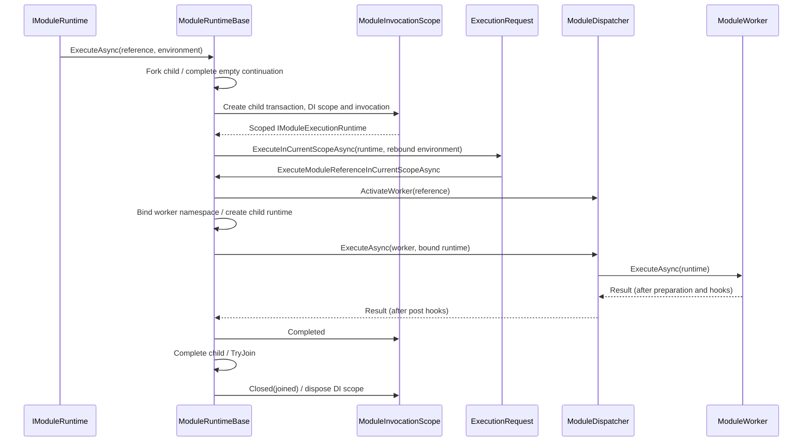
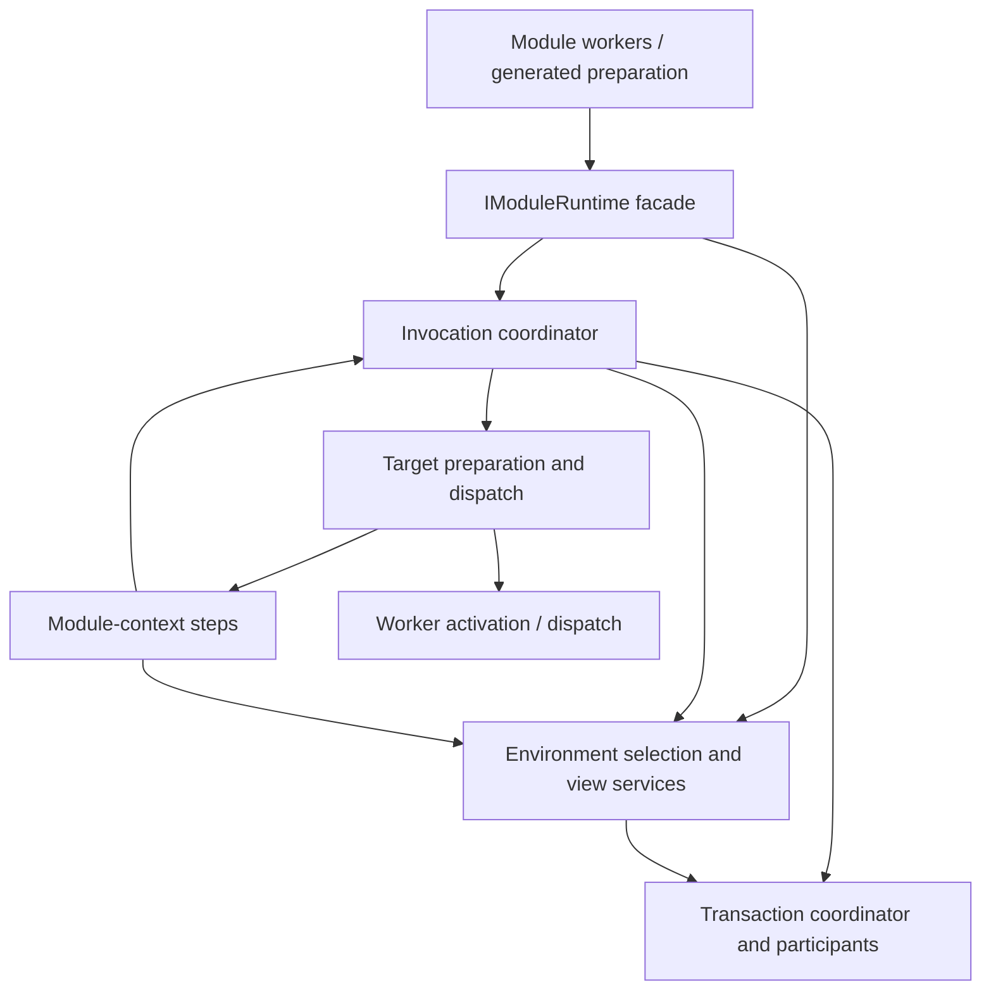

# Runtime Execution and Environment Management Refactor

This is a transition plan, not a description of the current steady-state architecture. The authoritative behavior remains documented in [System Architecture](../architecture/architecture-overview.md), [Transactional Execution](../architecture/transactions.md), and [Interpolation and Overrides](../architecture/interpolation.md). Apply this plan incrementally; integrate the accepted design into those documents after implementation, rather than maintaining two competing steady-state descriptions.

The plan is based on the October 12, 2026 `cyborg-main` snapshot, **before** the evaluated module-origin patch. That patch is design input only and is not part of the baseline. In particular, `ModuleOriginScope`, `TryReuseLiveView`, and the proposed contextual-property resolver do not exist in this baseline and must not be treated as existing dependencies.

## Goal and boundaries

Module dispatch and environment management currently encode several valid but distinct operations through one runtime inheritance hierarchy and one environment-context object. The behavior is soundly motivated, but following a module call requires navigating public and internal runtime methods, execution-request subclasses, invocation scopes, the context runner, worker activation, environment selection, transaction rebinding, and multiple environment-resolution overrides. Similar method names conceal materially different lifecycle boundaries.

The objective is to make those boundaries obvious in code, with a single comprehensible owner for each concern, without changing the observable module/runtime contract. This is not a rewrite of transaction reconciliation, the JSON/module-definition model, generated validation, or the value-expression language. In particular, avoid replacing one chain of higher-order callbacks with a larger web of interfaces and forwarding services.

The immediate work is structural. Support for file provenance and generalized contextual bindings is a **subsequent** feature, to be added only after the refactor establishes an explicit view descriptor and binding lifecycle.

## Dimensions and ownership

Four identities or relationships intersect in one module execution:

| Dimension | Describes | Owner and lifetime |
| --- | --- | --- |
| Module definition | Immutable definition, `ModuleReference`, optional future definition provenance; references may move as data | Configuration/registry value, independent of invocation |
| Module invocation | Execution ID, parent invocation ID, cancellation, DI scope, lifecycle events; a call can target any visible named environment | Structured invocation scope |
| Logical environment | `RuntimeEnvironmentId`, graph nodes, inherited parent edges, named registrations, `(environment ID, path)` values | Transaction environment participant; visibility depends on the current fork/continuation |
| Environment view | How a particular invocation or inherited edge sees a logical environment: namespace, override tags, and future contextual metadata, bound to a transaction | Immutable view descriptor plus a short-lived transaction-bound facade |

The module invocation ancestry is **not** the logical environment inheritance tree. Transaction ancestry determines which graph and bindings a branch can see; it does **not** select the contextual view for an environment ID. An environment ID may have multiple simultaneous views. No lookup may assume that equal logical IDs imply interchangeable namespace, override, or contextual bindings.

A useful invariant for the finished architecture is:

> Selecting an environment chooses a logical identity; binding a module chooses the view used to interpret it; binding a transaction chooses the state visible through it; reconstructing a structural parent uses the parent view descriptor stored with the logical topology.

None of those operations implicitly performs the other three.

## Existing dependency map

The following describes the baseline, not proposed APIs.

### Execution and dispatch

| Current type | Depends on / calls | Responsibilities currently combined |
| --- | --- | --- |
| `IModuleRuntime` | Used by module workers, generated validation, artifact publisher | Public facade for environments, child execution, structured concurrency, and result/artifact publication |
| `IModuleExecutionRuntime : IModuleRuntime` | Used by request subclasses, `ModuleContextRunner`, concurrent execution, test adapter | Engine-only current-scope dispatch, activated-worker execution, invocation/DI metadata |
| `RootModuleRuntime` / `ScopedRuntime` | Derive from `ModuleRuntimeBase` | Root composition versus invocation-specific runtime state |
| `ModuleRuntimeBase` | `ModuleExecutionRequest`, `RuntimeEnvironmentContext`, `ModuleRuntimeServices`, `ActiveTransaction`, `ModuleInvocationScope` | Public facade, transaction fork/join, invocation creation, context handling, worker activation, module binding, dispatch, concurrency entry point |
| `ModuleExecutionRequest` subclasses | Call `IModuleExecutionRuntime.Execute*InCurrentScopeAsync` | Five forms of execution are represented by polymorphic callbacks to the same runtime implementing the outer orchestration |
| `ModuleInvocationScope` | Child transaction, async DI scope, scoped runtime, lifecycle hooks | Lifetime owner and event notification facade; does not select the module environment |
| `ModuleContextRunner` | Engine runtime, environment, logger, environment factory | Required-argument staging, optional configuration-child invocation, then primary module reference |
| `ModuleDispatcher` | Worker factory, worker, post-execution hook pipeline | Worker activation and final dispatch/failure-to-result policy; validation/pre-execution hooks are inside `ModuleWorker<T>` |
| `ConcurrentExecutionScope` / `ConcurrentModuleExecution` | Transaction fork group, invocation-scope factory delegate, completion policy | Structured child start/observation, owner continuation, cancellation, join/discard and cleanup; each child chooses its environment after start |
| `ModuleArtifactPublisher` | `IModuleRuntime.PrepareEnvironment` and environment publication | Converts a module result into published artifacts in the selected transaction-bound environment |

Regular reference execution presently follows:

This is a **new invocation** wrapped around **dispatch within that invocation**. The distinction is necessary; the request-class round trip through `IModuleExecutionRuntime` is not. `ExecuteRootModuleAsync` intentionally skips the usual `ModuleContextRunner` configuration/requirements path. Loaded configurations seed the named-module registry before their main module runs. A normal `ModuleContext` runs its optional configuration module as a **separate nested invocation** and its primary module inside the already established context invocation. Preserve all three differences.

### Environment management

| Current component | Existing role | Coupling / navigation issue |
| --- | --- | --- |
| `RuntimeEnvironmentContext` | Runtime frame ancestry, current/parent/global selection, named lookup, logical-node creation, reconstruction, `EnsureEnvironmentExists`, transaction rebind | Execution ancestry and structural topology are traversed by the same object, with several `BindEnvironment` / `CreateEnvironment*` operations |
| `IRuntimeEnvironmentFactory` / `DefaultRuntimeEnvironmentFactory` | Create global/unbound views; instantiate inherited/non-inherited transactional views; attach common runtime services; transaction-bind existing views | View materialization and runtime service attachment are reasonable responsibilities but sit behind a generic factory with multiple unrelated creation modes |
| `RuntimeEnvironment` / `InheritedRuntimeEnvironment` | Transaction-bound variable access; namespace/override tags; parent fallback; typed and raw override resolution | Repeated virtual `Try*Core` methods intertwine hierarchy traversal, selected-entry-point behavior, evaluation and type conversion |
| `EnvironmentLike` | Variable storage and expression grammar/evaluation; interpolation, capture, indirection | Should remain the semantic core; avoid a simultaneous expression-language rewrite |
| `RuntimeEnvironmentTransactionState` | Graph + `(ID, path)` bindings | Correct transactional state boundary |
| `RuntimeEnvironmentGraphState` | `Nodes` and `Registrations` dictionaries | Correct location for logical identity/parent relationships, but not the source of invocation context |
| `RuntimeEnvironmentParent` | Parent environment ID, namespace, override-resolution tags | Already a partial *structural parent-view descriptor*, not merely an ID pointer |

For `Reference`, `RuntimeEnvironmentContext.TryGetEnvironment` first searches current/ancestor runtime frames for a matching environment *name*, then falls back to the current transaction's `Registrations` and reconstructs the logical node and its parent chain. For `InheritParent` / `InheritGlobal`, it records the selected parent view's ID, namespace and tags in the transaction graph when creating a new node. For `Current` / `Parent`, it selects an existing view and binds the namespace to `__UNBOUND`; the next worker bind supplies the module namespace. This path differs from creating a new environment node.

Reconstruction in this baseline uses the stored `RuntimeEnvironmentParent` metadata; it does **not** find a live parent view by ID. Preserve that property during refactoring. A future provenance extension must not add opportunistic ID-only live-view substitution.

### Transactions and concurrency

`RootModuleRuntime` seeds the global node and creates the root `TransactionCoordinator` with environment, named-module-registry and custom transactional-service participants. `ActiveTransaction` is an invocation-scoped pointer; `ConcurrentExecutionScope` temporarily retargets it to the **owner continuation** while child branches run, then restores it when the fork closes. `RuntimeEnvironmentContext.CreateTransactionView` recursively rebinds runtime frames and environment parent-view chains to a child transaction, without cloning environment values or reconstructing logical topology.

Sequential execution uses a fork group with one child and a completed empty continuation. Concurrent scopes use the same transaction semantics but own several child invocations and a live continuation. Reconciliation is all-or-nothing across participants; participant-specific `OnError` policy determines each child's workflow-data publication. Debugger branch-control participants and user transactional services share that atomic boundary. These behaviors are not incidental implementation details and must survive the refactor unchanged.

### Dependency direction we want to remove

Currently, the runtime both *owns* orchestration and is *called back by* `ModuleExecutionRequest`, `ModuleContextRunner`, and `ConcurrentExecutionScope` to continue orchestration. Meanwhile, runtime environment selection calls into transaction topology and runtime-frame ancestry, and the object representing an environment owns the resolution traversal. The result is a cycle of control even though the state dependency direction is mostly correct.

The revised design should flow predominantly in one direction:

The `Runner --> Coordinator` edge is an intentional request for a **new child invocation** for configuration modules; it must not call back into lower-level current-scope runtime dispatch. Other edges should not reverse without a concrete ownership reason. For concurrent execution the coordinator supplies the same invocation-scope creator to the existing structured scope; the transaction coordinator remains responsible for fork lifecycle and atomic join.

## Target responsibilities

This is a conceptual boundary proposal, not a mandate to introduce one interface/class per row. Prefer consolidating a small number of cohesive internal types and deleting forwarding layers. Names may change during implementation, but their responsibilities must not drift.

| Responsibility | Proposed owner | Explicit contract |
| --- | --- | --- |
| Module-facing API and contextual access | `IModuleRuntime` plus a small scoped facade | Stable public/generator-facing methods, environment access, `Exit`, child-invocation requests. No fork/join or worker activation implementation in the facade. |
| Invocation coordination | `ModuleInvocationCoordinator` (one engine-owned component) | Creates/reconciles child transaction, creates/disposes DI scope and invocation identity, delivers `Started` / `Completed` / `Closed`, handles exceptional teardown. Provides one path for sequential children and the child scope used by concurrent execution. |
| Target interpretation | Explicit execution target/plan internal to coordinator | Distinguishes `ModuleContext`, loaded configuration, loaded root, reference and activated worker. No polymorphic request object calling a second runtime interface just to re-enter the same dispatcher. |
| Module-context orchestration | `ModuleContextRunner` (retained but narrowed) | Stage required arguments; execute optional configuration child; dispatch primary module in current invocation. Loaded-root bypass and registry-seeding order stay explicit. |
| Worker lifecycle | Existing `ModuleDispatcher` and `ModuleWorker<T>` | Activate using execution DI; pass a fully bound module runtime to validation, pre/post hooks and execution. Dispatcher retains current exception-to-result and post-hook behavior. |
| Invocation frame | Narrow runtime frame object | Read-only parent/current/global views, invocation identity, current scoped DI and active transaction pointer; ancestry is not the logical environment parent tree. |
| Scope selection and named lookup | `EnvironmentScopeSelector` (or a similarly cohesive internal component) | Resolve `Current`, `Parent`, `Global`, `Reference` against runtime frame ancestry and transaction-visible registrations; request creation for other scopes. Does not invent view bindings. |
| Logical graph mutation / access | Existing `RuntimeEnvironmentTransactionState` behind a narrow internal operation surface | Create nodes, register names, read nodes, validate references and seed/import foreign environment views in the selected transaction. Remains participant-owned. |
| View construction / rebinding | `EnvironmentViewMaterializer` built around the existing factory | Construct a transaction-bound view from `(ID, view descriptor, selected transaction)`; reconstruct parent descriptors from graph; rebind existing view without changing its descriptor. Does not inspect the module call stack to find an allegedly equivalent view. |
| Expression and override resolution | `EnvironmentLike` and environment-view family, initially unchanged | Preserve current entry-point, textual/typed/eager, tag and override contracts. Simplify parent traversal in a later isolated phase only with parity tests. |
| Concurrency lifetime | `ConcurrentExecutionScope` / `ConcurrentModuleExecution`, retaining a shared invocation-scope abstraction | Own continuation, child cancellation/observation, close/discard and scoped DI cleanup. Do not create a second fork or special transaction model. |

### Environment view descriptor

Represent the metadata that differentiates two views of the same logical environment as an **immutable descriptor**: currently namespace and override-resolution tags; later optionally immutable definition/context metadata. The structural `RuntimeEnvironmentParent` should record the descriptor of the parent view selected when the inheritance edge was created. Materialization combines that descriptor with the transaction-visible logical node and variable bindings. It must not infer a descriptor from an active runtime view with a matching ID.

We do **not** need an independent provenance graph. Module-reference provenance and inherited-parent snapshots have different owners. Capturing a view descriptor in a newly created child environment is an intentional transactional **topology** change; it is not writing mutable `@.*` variables into the parent's bindings. Future invocation-only context (e.g. a live cancellation token) must not be blindly captured into durable descriptors. Decide its semantics separately when introduced.

For this refactor, **do not add file provenance**. Establish a descriptor sufficient to reproduce existing namespace/tag behavior, so provenance can later be added without changing topology traversal again.

### New invocation versus current-invocation execution

Do not remove this semantic distinction when simplifying `IModuleExecutionRuntime`:

- **Start child invocation**: forks and isolates transaction state, opens child DI scope, creates child execution identity, emits lifecycle observations, closes child transaction and joins/discards.
- **Dispatch within established invocation**: selects/prepares module execution context, resolves requirements and optional configuration-child policy, activates a worker and binds its namespace, then executes generated validation and worker hooks. It must not fork again merely because the target representation is different.

The public `IModuleRuntime` stays stable initially, including generated-contract compatibility. Replace the broad `IModuleExecutionRuntime : IModuleRuntime` only after its callers (`ModuleExecutionRequest`, `ModuleContextRunner`, concurrency, test adapter, debugging extensions) have explicit engine-owned entry points. `IModuleExecutionRuntime` may disappear or shrink to a narrow internal runtime metadata interface; it should not be replaced with another large pass-through interface.

### Lifecycle sequencing is a contract

A structured `Started` event currently fires **after** creating the child invocation/DI scope but **before** failure-prone environment preparation or worker activation. `Completed` fires only when a definite result exists, before the child transaction completes; `Closed` follows join or discard, including errors before a result. Worker validation/pre-execution and dispatch post-execution hooks are different pipelines. Preserve these observability guarantees and the debugger's live execution tree. Do not silently move `Started` after worker binding to simplify future provenance availability; if provenance is required on those events, first define whether it is carried by invocation metadata or a worker-bound environment and account for pre-dispatch failure events.

## Step-by-step migration

Each phase is a coherent local feature branch/patch off the last **approved** baseline. Preserve the approved baseline, return patches for review, and do not merge a phase until approved. Names below describe conceptual boundaries; avoid generating new types where a small extraction into an existing cohesive type suffices.

### P0. Characterize behavior and the existing call graph

**Change:** Tests and internal documentation only. Add a compact call-site/dependency inventory alongside this plan if implementation work uncovers paths not listed above. Ensure that the existing test suite runs with the provided SDK/offline dependencies before changing behavior.

**Characterize:**

1. The five public execution forms and their difference in registry seeding, configuration-child execution, root bypass and worker activation.
2. `Started` / `Completed` / `Closed` on success, cancellation, worker failure, configuration/preparation error, join conflict and abandoned parallel scope.
3. `InheritParent`, `InheritGlobal`, `Isolated`, `Current`, `Parent`, `Global`, `Reference`: node creation versus view selection, names/transience, and lookup order.
4. Two module views on one logical environment ID with different namespaces/tags; named environment creation followed by immediate reference; named reference after the creator exits; parent fallback versus entry-point interpolation.
5. Child writes, owner continuation, rollback publication, sibling conflicts, transient pruning, retained ancestors and named-registry visibility across fork/join.

**Acceptance:** No production behavior changes; new tests reproduce the baseline behavior independently of the future design. Record tests that cannot be run. Suggested commit: `P0: Characterize runtime execution and environment contracts`.

### P1. Make environment selection and materialization explicit

**Change:** Split `RuntimeEnvironmentContext` responsibilities first, without changing its public consumers. Extract cohesive internals for (a) frame-based scope/name selection, (b) transactional graph access/creation, and (c) deterministic view materialization. Keep a thin compatibility facade temporarily while callers migrate.

**Implementation path:**

1. Encapsulate ID extraction and transaction-state membership checks in one place; distinguish *selecting an existing view* from *creating a new logical node*.
2. Move `CreateEnvironmentViewCore` into the view materializer; materialize stored `RuntimeEnvironmentParent` metadata recursively with cycle detection. Keep `DefaultRuntimeEnvironmentFactory` responsible only for constructing/binding a view and attaching its runtime services.
3. Move registry lookup and `Current`/`Parent`/`Global` selection to the scope selector. Preserve the existing priority of execution-frame name matches before transaction-registry fallback.
4. Keep the transactional graph as the authority for named registrations and parent edges. Ensure that importing an external/test environment view (`EnsureEnvironmentExists`) creates topology and bindings atomically according to existing behavior.
5. Make **bind view** (namespace/tags), **bind transaction**, and **materialize from structural descriptor** visibly distinct operations; avoid `Bind*` overloads with hidden graph mutations.

**Acceptance:** Existing environment-scoping/transaction tests plus P0 scenarios pass. Repeated materialization in the same branch returns equivalent resolution semantics even if the runtime-frame hierarchy differs. No execution coordinator changes yet. Suggested commit: `P1: Separate environment selection from view materialization`.

### P2. Narrow runtime frames and transaction rebinding

**Change:** Make the runtime frame an explicit invocation-ancestry structure, rather than the owner of logical graph operations. The frame retains current/global view, parent frame, scoped execution identity and the active-transaction pointer where needed. Environment APIs delegate to P1's selector/materializer.

**Implementation path:**

1. Preserve `ParentEnvironment` as the parent **invocation frame** view, not `InheritedRuntimeEnvironment.Parent`.
2. Make transaction rebinding of a view/frame explicit and recursive. Rebind both current and global views to the selected child/continuation transaction without re-selecting structural parents.
3. Verify that mutable `ActiveTransaction.Retarget()` during an open concurrent scope still changes the owner's variable state destination without changing invocation ancestry or view metadata.
4. Reduce overlap between the frame, `RuntimeEnvironmentContext` compatibility facade and `ModuleRuntimeBase`; remove the temporary facade only when all call sites use the new owner.

**Acceptance:** Existing concurrency and environment tests; explicit regression for `ParentEnvironment` versus structural `.Parent`, nested fork/continuation and named-reference access after transaction rebinding. Suggested commit: `P2: Isolate invocation frames and transaction-bound views`.

### P3. Centralize invocation scope ownership

**Change:** Extract the body of `ModuleRuntimeBase.ExecuteInNewScopeAsync` and scope creation into one invocation coordinator. Keep `ModuleInvocationScope` as the owned lifetime object. Both normal sequential calls and concurrent children use its scope-construction method; retain the concurrency scope's join/abandon policy.

**Implementation path:**

1. Move fork/empty-continuation, child-transaction creation, DI-scoped participant binding, invocation ID creation and lifecycle notifications into coordinator methods with explicit inputs.
2. Keep a single ownership policy for `ModuleInvocationScope` dispose/close and exception cleanup. Preserve `Completed` only on definite results and `Closed` after join/discard.
3. Connect `ConcurrentExecutionScope` through a narrow invocation-scope creator, preferably a method reference or small owned collaborator rather than an unconstrained higher-order dispatch callback. It must still retarget/restore the owner continuation and observe every child.
4. Keep the root runtime's participant composition and host service registrations unchanged during extraction.

**Acceptance:** Lifecycle, debugger topology, transaction conflict, rollback policy, parallel/sidecar cancellation, and nested fork ownership tests pass. The facade no longer owns transaction reconciliation. Suggested commit: `P3: Centralize invocation transaction and DI lifecycle`.

### P4. Flatten dispatch without changing execution forms

**Change:** Remove the `ModuleExecutionRequest` subclass-to-`IModuleExecutionRuntime` callback cycle. Give the coordinator a small explicit target/dispatch representation (or direct typed entry methods) and have one engine-owned dispatcher implement the current-invocation path.

**Implementation path:**

1. Preserve individual entry points for `ModuleContext`, loaded configuration, loaded root, `ModuleReference`, and activated worker. Make their differences visible in the coordinator/target handler instead of spreading them across five request subclasses and similarly named runtime interface methods.
2. Keep loaded registry seed application **inside** the invocation before context/worker execution; preserve the loaded-root bypass of optional configuration and required arguments.
3. Keep the normal context runner's requirements staging and optional configuration-child call. Ensure that the configuration child creates its own invocation and the primary reference uses the enclosing scope.
4. Activate from the invocation DI scope; bind module namespace **before** generated module preparation; keep validation, worker execution, exception-to-result mapping, post-hook observation and `Exit` artifact publication behavior.
5. Update the test adapter's activated-worker path. Once all callers are explicit, eliminate or narrow `IModuleExecutionRuntime`; keep `IModuleRuntime` and its generator contract stable.

**Acceptance:** One readable call path for each execution form, no redundant fork/DI scope, stable result and hook ordering, generated-validation and dynamic/template/registry-module tests pass. Suggested commit: `P4: Flatten execution target dispatch`.

### P5. Simplify environment resolution traversal independently

**Change:** Reduce repeated hierarchy/override traversal in `RuntimeEnvironment` and `InheritedRuntimeEnvironment` without changing language semantics. This phase is deliberately after environment ownership and dispatch boundaries have stabilized.

**Implementation path:**

1. Inventory each `Try*Core` override and distinguish **lookup across parent views**, **override candidate precedence**, **value-expression evaluation**, and **typed/result conversion**.
2. Consolidate common traversal where it improves readability, preserving the original entry point throughout inheritance. Avoid a general visitor/HOF pipeline that hides control flow or performs resolution more than once.
3. Preserve raw textual override selection (including shielding) separately from evaluated typed overrides; preserve terminal/snapshot behavior, tagged strings, cycle detection, layered escaping and `@`/`@@` semantics.
4. Keep generated-validation phase order untouched. Prefer small helper methods and direct loops over new generic frameworks.

**Acceptance:** Exact behavior parity with [Interpolation and Overrides](../architecture/interpolation.md), including parent-stored expressions resolved from children, overrides via name/group/module ID/tags, typed collections, tagged conversion and snapshot capture. Suggested commit: `P5: Consolidate inherited variable and override traversal`.

### P6. Add contextual provenance on the stable model (separate feature)

**Change:** Only after P1–P5, integrate the separately reviewed origin feature with module-reference-owned immutable provenance, per-load deserialization context rather than ambient CLR scope, and runtime-owned contextual view values.

**Implementation path:**

1. Attach a canonical origin to every module reference defined by a loaded file, including nested, dynamic and module-valued configuration-map data; programmatic references may omit or explicitly supply it.
2. Carry origin through a per-deserialization-operation converter/options/context boundary, not a process-global `AsyncLocal`. Independently parsed module data must not inherit an unrelated file's origin.
3. Bind a module's context to the selected current view when executing the reference; never write `@.*` into ordinary transactional bindings. Distinguish execution-worker context from structured lifecycle-event identity before exposing context to hooks.
4. Capture only durable contextual view metadata on structural inheritance edges. A child bound to a new module gets the new module's context while its parent edge still describes the captured parent view. Avoid serializing live invocation objects/services.
5. Resolve contextual references through the same scoped expression machinery as namespace self-reference, preserving entry-point, lazy/eager, missing-value and read-only semantics.

**Acceptance:** Module-as-data retains its definition origin; named-environment reconstruction is deterministic after creator exit; transaction fork/join does not publish contextual variables; test adapter supports explicit origin and lifecycle tests cover bound/unbound phases. Document lazy interpolation against captured parent views clearly. Suggested commit: `P6: Add module provenance through contextual environment views`.

## Acceptance checklist for the whole migration

- [ ] Public `IModuleRuntime` and source-generated validation/loader contracts are source/behavior compatible through P5.
- [ ] The five invocation forms retain their distinct root, configuration, registry and activated-worker behavior.
- [ ] Each invocation opens one child transaction and DI scope, with stable execution IDs, correct parent IDs, deterministic hook order and exactly-once close/dispose.
- [ ] All started concurrent children are observed; owner continuation writes are isolated until reconciliation; close/discard and rollback rules are unchanged.
- [ ] The logical graph and named registry remain transaction-visible by branch; conflicts are atomic and unreachable transient state is pruned.
- [ ] Environment scope selection preserves current/global/parent frame semantics, name lookup priority and reference failure behavior.
- [ ] Same logical ID does not imply interchangeable contextual views; structural parent materialization uses recorded namespace/tag descriptors.
- [ ] Transaction rebinding preserves view descriptors and environment identity without cloning environment variable objects or consulting execution ancestry.
- [ ] Variable and override resolution preserve all documented expression, capture, escaping and tagged-value behavior.
- [ ] Debugger pre-execution and structured-lifecycle hooks, artifact publication, the CLI composition root and production-backed test adapter continue to work.
- [ ] Added APIs are narrow and purposeful; retired callback/request/forwarding layers are deleted, not merely wrapped by additional layers.
- [ ] The new code respects native-AOT/source-generation boundaries and repository formatting, and steady-state docs are updated only when their behavior changes.

## Review and validation workflow

Use the [local development workflow](https://github.com/frederik-hoeft/custom-skills/blob/main/dev/local-development.skill): build each approved phase on a fresh local feature branch, return a standalone patch against the then-approved baseline, apply review follow-ups incrementally, and merge only after approval. Keep planning artifacts in `docs/internal/`; once implemented, reconcile architectural contracts into `docs/architecture/` and retire obsolete transition-only details rather than duplicating them indefinitely.

Primary regression entry points include `ModuleRuntimeBaseTests`, `ModuleExecutionLifecycleTests`, `ConcurrentExecutionScopeTests`, `ParallelModuleRuntimeTests`, `TransactionalRuntimeEnvironmentTests`, `TransactionCompletionPolicyTests`, `RuntimeModuleRegistryTransactionTests`, `NamedModuleTransactionTests`, the interpolation/override tests, `Cyborg.Core.TestAdapter`, and debugger tests. For each phase, use targeted tests first, then `dotnet test Source/Cyborg.slnx` (or the repository's supported equivalent) when the SDK and restore assets permit. Check native-AOT publication for phases affecting generated contracts or serialization. Record build/restore limitations explicitly. Use `git diff --check` and review the full phase diff before generating the patch.

Do not start P6 opportunistically during P1–P5; it is an independent feature with different acceptance criteria. Similarly, do not refactor the transaction coordinator, change conflict policy, or alter source-generator validation order unless a concrete test demonstrates that the existing contract cannot be preserved under the proposed boundaries.
